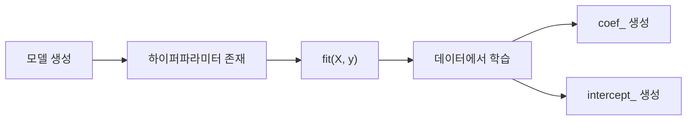

선형 회귀 코드를 보다가 이런 부분이 눈에 들어왔다.

```python
beta_0 = simplelinear.intercept_
beta_1 = simplelinear.coef_
```

처음에는 이런 생각이 들었다.

> "절편과 기울기를 구하는 함수라면 `coef()`처럼 괄호가 붙어야 하는 것 아닌가?"

게다가 이름 뒤에는 왜 `_`가 붙어 있을까?

이 질문을 따라가다 보니 scikit-learn에서 **메서드와 속성을 구분하는 방법**, 그리고 **학습 전에 존재하는 설정값과 학습 후 생기는 결과값을 구분하는 네이밍 규칙**을 알게 됐다.

---

## coef_와 intercept_는 함수가 아니다

먼저 가장 중요한 차이부터 보자.

```python
model.fit(X_train, y_train)
```

`fit()`은 함수처럼 실행한다.

정확히는 클래스 내부에 정의된 **메서드(method)**다.

반면 다음 코드는 괄호가 없다.

```python
model.coef_
model.intercept_
```

이 둘은 실행하는 함수가 아니라 **학습이 끝난 뒤 모델 객체 안에 저장된 값**, 즉 속성(attribute)이다.

```text
fit()
→ 실행한다

coef_
→ 읽는다

intercept_
→ 읽는다
```

---

## 실제 선형 회귀 예제

```python
import numpy as np
from sklearn.linear_model import LinearRegression

X = np.array([
    [1],
    [2],
    [3],
    [4]
])

y = np.array([5, 8, 11, 14])

model = LinearRegression()
model.fit(X, y)

print(model.coef_)
print(model.intercept_)
```

이 데이터는 대략 다음 관계를 가진다.

```text
y = 3x + 2
```

따라서 학습 결과는 다음과 비슷하다.

```text
coef_ = [3.]
intercept_ = 2.
```


`coef_`는 입력 특성이 예측값에 미치는 기울기, 즉 회귀계수다.

`intercept_`는 입력값이 0일 때의 기준점인 절편이다.

---

## 왜 이름 뒤에 _를 붙일까?

scikit-learn에는 중요한 네이밍 규칙이 있다.

> `fit()`을 통해 데이터로부터 추정된 속성은 이름 끝에 밑줄 `_`을 붙인다.

예를 들어:

```python
model.coef_
model.intercept_
```

이 값들은 모델 객체를 생성한 직후에는 학습된 값이 아니다.

```python
model = LinearRegression()
```

이 시점에는 아직 데이터로부터 학습한 회귀계수가 없다.

그 다음:

```python
model.fit(X, y)
```

를 실행하면 데이터에서 패턴을 학습하고, 그 결과가 객체 내부에 저장된다.

```python
model.coef_
model.intercept_
```

즉 `_`는 단순한 장식이 아니라 다음 의미를 전달한다.

```text
이 값은 사용자가 직접 넣은 설정값이 아니라,
fit() 이후 데이터로부터 학습된 결과다.
```


---

## 생성자 파라미터와 학습된 속성의 차이

예를 들어 다음 모델을 보자.

```python
from sklearn.linear_model import Ridge

model = Ridge(alpha=1.0)
```

여기서 `alpha`는 사용자가 모델을 만들 때 직접 지정한 **하이퍼파라미터**다.

```python
model.alpha
```

처럼 접근할 수 있다.

반면:

```python
model.fit(X, y)
```

이후 생성되는:

```python
model.coef_
model.intercept_
```

는 데이터에서 학습된 값이다.

정리하면:

| 구분 | 예시 | 의미 |
|---|---|---|
| 설정값 | `alpha` | 사용자가 지정 |
| 학습 결과 | `coef_` | fit 후 데이터에서 추정 |
| 학습 결과 | `intercept_` | fit 후 데이터에서 추정 |

이 네이밍 규칙 덕분에 코드를 읽을 때도 해당 값의 성격을 어느 정도 추측할 수 있다.

---

## fit 전에 coef_를 읽으면 어떻게 될까?

다음 코드를 실행한다고 해보자.

```python
model = LinearRegression()

print(model.coef_)
```

아직 학습하지 않았기 때문에 `coef_`는 만들어지지 않았다.

즉 다음 흐름을 기억해야 한다.



scikit-learn에서 자주 보는 다음 속성들도 같은 맥락이다.

```python
classes_
feature_names_in_
n_features_in_
cluster_centers_
```

모델이나 변환기에 따라 다르지만, 공통적으로 `fit()` 이후 학습 데이터로부터 결정된 값에는 뒤 밑줄이 붙는 경우가 많다.

---

## coef_의 shape는 왜 모델마다 다를까?

여기서 `coef_`를 출력했을 때 숫자 하나가 아니라 배열이 나오는 것도 처음에는 낯설 수 있다.

```python
print(model.coef_)
```

예를 들어 특성이 하나라면:

```text
[3.]
```

특성이 세 개라면:

```text
[1.2, -0.8, 4.5]
```

입력 특성마다 하나의 회귀계수가 필요하기 때문이다.

선형 회귀식은 다음과 같다.

```text
y = β0 + β1x1 + β2x2 + ... + βpxp
```

- `intercept_` → β0
- `coef_[0]` → β1
- `coef_[1]` → β2
- ...

따라서 특성 수를 확인하면 `coef_`의 의미도 이해하기 쉽다.

---

## X.shape[1]은 왜 사용하는가?

실습 코드에서 다음을 본 적이 있다.

```python
print("데이터의 입력값(X)의 개수 :", X.shape[1])
```

`shape`는 배열의 크기를 알려준다.

예를 들어:

```python
X.shape
```

결과가 다음과 같다면:

```text
(506, 13)
```

의미는:

- 행 506개 → 샘플 506개
- 열 13개 → 특성 13개

따라서:

```python
X.shape[0]
```

은 샘플 수이고,

```python
X.shape[1]
```

은 특성 수다.

즉 `X.shape[1]`을 출력한 이유는 "이 데이터셋에는 입력 변수가 몇 개 있는가?"를 확인하기 위해서다.

이 값은 `coef_`와도 연결된다.

다중 선형 회귀라면 보통 각 입력 특성마다 회귀계수 하나가 필요하므로:

```text
특성 수 ≈ coef_의 원소 수
```

로 이해할 수 있다.

---

## return_X_y=True는 왜 사용할까?

scikit-learn의 데이터셋 로더에서는 다음과 같은 코드를 자주 볼 수 있다.

```python
X, y = load_wine(return_X_y=True)
```

`return_X_y=True`를 사용하면 입력 데이터와 타깃을 바로 분리해서 받을 수 있다.

```python
X, y = ...
```

즉 머신러닝에서 가장 익숙한 형태로 바로 받는 것이다.

반면 기본 형태에서는 데이터와 타깃, 메타정보 등이 하나의 객체에 담겨 반환되는 경우가 많다.

예를 들면:

```python
data = load_wine()

X = data.data
y = data.target
```

`return_X_y=True`를 사용하면 이 과정을 짧게 쓸 수 있다.

```python
X, y = load_wine(return_X_y=True)
```

두 방식의 목적은 같다.

---

## fit()은 정확히 무엇을 하는가?

머신러닝 코드에서 `fit()`은 거의 항상 등장한다.

```python
model.fit(X_train, y_train)
```

선형 회귀를 예로 들면, `fit()`은 학습 데이터를 사용해 오차를 줄이는 회귀계수와 절편을 찾는다.

그 결과를 모델 객체 내부에 저장한다.

```text
입력 데이터 X
+
정답 y
↓
fit()
↓
학습
↓
coef_, intercept_
```

따라서 `fit()`은 단순히 "모델을 실행하는 함수"가 아니라 **모델 내부 상태를 학습된 상태로 바꾸는 과정**이라고 보는 것이 더 정확하다.

---

## predict()와 coef_는 역할이 다르다

다음 두 코드를 비교해보자.

```python
model.predict(X_test)
```

```python
model.coef_
```

`predict()`는 새로운 입력값을 받아 예측값을 계산하는 메서드다.

반면 `coef_`는 이미 학습된 모델 내부의 값을 확인하는 속성이다.

| 코드 | 종류 | 역할 |
|---|---|---|
| `fit()` | 메서드 | 학습 |
| `predict()` | 메서드 | 예측 |
| `coef_` | 속성 | 학습된 계수 확인 |
| `intercept_` | 속성 | 학습된 절편 확인 |

괄호의 유무도 여기서 자연스럽게 이해할 수 있다.

```python
fit()
predict()
```

는 실행해야 하므로 괄호가 있다.

```python
coef_
intercept_
```

는 저장된 값을 읽으므로 괄호가 없다.

---

## 내가 처음에 잘못 생각했던 부분

처음에는 다음처럼 생각했다.

```text
회귀계수를 구한다
→ 어떤 계산을 실행한다
→ coef() 같은 함수일 것이다
```

하지만 실제로는 `fit()`이 계산을 이미 끝낸다.

```python
model.fit(X, y)
```

이 순간 모델이 회귀계수와 절편을 계산하고 객체 내부에 저장한다.

그 이후에는 계산 함수를 다시 실행하는 것이 아니라 결과를 꺼내 읽는다.

```python
model.coef_
model.intercept_
```

그래서 괄호가 없는 것이다.

---

## 실무에서는 coef_만 보고 모델을 해석해도 될까?

선형 모델에서는 회귀계수를 해석할 수 있지만 주의가 필요하다.

예를 들어 특성마다 단위가 다르면 계수의 절댓값만 단순 비교하기 어렵다.

```text
연봉: 원 단위
나이: 년 단위
주행거리: km 단위
```

단위가 다르면 숫자의 크기도 달라지기 때문이다.

따라서 계수 크기를 비교하고 싶다면 상황에 따라 스케일링이 필요할 수 있다.

또한 다중공선성이 심하면 계수가 불안정해질 수도 있다.

즉:

```text
coef_가 크다
= 무조건 가장 중요한 변수다
```

라고 단정하면 안 된다.

모델 구조, 전처리, 변수 단위와 상관관계를 함께 봐야 한다.

---

## 면접에서 설명한다면

**Q. scikit-learn에서 `coef_`처럼 이름 끝에 `_`가 붙는 이유는 무엇인가요?**

scikit-learn에서는 일반적으로 `fit()`을 통해 데이터로부터 추정된 속성에 trailing underscore를 붙입니다. 예를 들어 `LinearRegression`의 `coef_`와 `intercept_`는 모델 생성 시점에 사용자가 지정하는 값이 아니라 학습 이후 생성되는 fitted attribute입니다.

**Q. 왜 `coef_()`가 아니라 `coef_`인가요?**

`coef_`는 메서드가 아니라 학습된 값을 저장하는 속성이기 때문입니다. 계산은 `fit()` 단계에서 수행되고, 이후에는 저장된 결과를 읽습니다.

---

## 정리

```python
model.fit(X, y)
```

- 학습을 수행하는 메서드

```python
model.coef_
```

- 학습된 회귀계수
- fit 이후 생성되는 속성

```python
model.intercept_
```

- 학습된 절편
- fit 이후 생성되는 속성

그리고 이름 뒤의 `_`는 scikit-learn에서 매우 중요한 힌트다.

> 이 값은 데이터로부터 학습된 결과다.

처음에는 `coef_`의 밑줄 하나가 단순한 네이밍처럼 보였지만, 이 규칙을 알고 나니 scikit-learn 문서를 읽을 때 어떤 값이 설정값이고 어떤 값이 학습 결과인지 훨씬 빠르게 구분할 수 있게 됐다.
